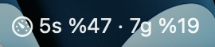
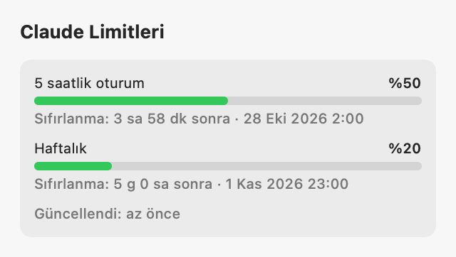
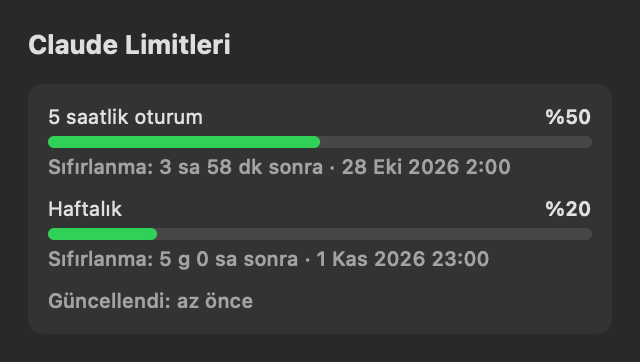

# Claude Usage Bar

Claude Pro/Max planınızın **5 saatlik oturum** ve **haftalık** limit yüzdelerini macOS menü çubuğunda gösteren küçük, native bir uygulama.



<p>
  
  
</p>

- **Menü çubuğunda** iki yüzde birden (`5s %47 · 7g %19`), yalnızca 5 saatlik yüzde ya da yalnızca ikon.
- **Popover'da** her limit için yüzde çubuğu, sıfırlanmaya geri sayım ve son güncelleme zamanı.
- **Eşik bildirimi:** Örneğin %80 geçildiğinde, her pencere için bir kez.
- **Login'de otomatik başlatma** (`SMAppService`).
- **Tamamen yerel:** Ağ erişimi yok, telemetri yok, harici bağımlılık yok.

Yüzdeler doğrudan Claude Code'un status line'a verdiği limit verisinden gelir; uygulama kendi tahminini üretmez.

## Gereksinimler

- macOS 13 Ventura veya üstü
- Swift 6 araç zinciri: Xcode **ya da** yalnızca Command Line Tools (`xcode-select --install`)
- [Claude Code](https://code.claude.com), claude.ai **Pro veya Max** hesabıyla giriş yapılmış olarak

## Kurulum

```bash
git clone https://github.com/ckaemm/claude-usage-bar.git
cd claude-usage-bar
./build.sh --install                 # derler ve /Applications/ClaudeUsageBar.app olarak kurar
open /Applications/ClaudeUsageBar.app
```

Ardından menü çubuğu ikonu › ⚙︎ **Ayarlar › Claude Code bağlantısı › Kur**. Claude Code'da bir mesaj gönderdiğinizde yüzdeler gelmeye başlar.

Uygulama Dock'ta görünmez, yalnızca menü çubuğunda yaşar. Kapatmak için popover'daki ⏻ butonuna basın ya da ⌘Q kullanın.

### Login'de otomatik başlatma

**Ayarlar › Login'de otomatik başlat** seçeneğini açın. macOS onay isterse **Sistem Ayarları › Genel › Giriş Öğeleri** sayfasından izin verin; ayarlardaki "Aç" butonu sizi doğrudan oraya götürür.

Elle eklemek için: **Sistem Ayarları › Genel › Giriş Öğeleri** sayfasında "Oturum Açıldığında Aç" listesindeki **+** butonuna basın ve `/Applications/ClaudeUsageBar.app` uygulamasını seçin.

## Nasıl çalışır

Claude Code, [status line](https://code.claude.com/docs/en/statusline) script'ine her güncellemede stdin üzerinden bir JSON gönderir. Bu JSON plan limitlerini de içerir:

```json
"rate_limits": {
  "five_hour": { "used_percentage": 23.5, "resets_at": 1738425600 },
  "seven_day": { "used_percentage": 41.2, "resets_at": 1738857600 }
}
```

`used_percentage` 0–100 arası bir sayıdır. `resets_at` ise Unix epoch saniyesidir.

```
Claude Code ──stdin JSON──▶ ~/.claude-usage-bar/statusline.sh ──▶ ~/.claude-usage-bar/limits/<session_id>.json
                                                                              │
                                              Claude Usage Bar ◀──FSEvents────┘
```

**Kur** butonu, küçük bir bash script'ini `~/.claude/settings.json` içindeki `statusLine` ayarına bağlar. Script'in özellikleri:

- **Bağımlılık yok:** Saf bash, çağrı başına yaklaşık 10 ms.
- **Oturum başına dosya:** Girdide `rate_limits` varsa JSON'u o oturuma ait dosyaya atomik olarak yazar (geçici dosya + `mv`, izin `0600`).
- **Sessiz hata:** Hiçbir hatada çıktıyı bozmaz, her zaman 0 koduyla çıkar.
- **Claude Code içinde özet:** Alt satırda `5s %23 · 7g %41` gösterir.

**Neden oturum başına dosya?** Her Claude Code oturumu yalnızca kendi son yanıtındaki yüzdeyi bilir. Tek bir dosya olsaydı, boşta duran bir oturum eski değeriyle güncel değeri ezebilirdi. Uygulama bu yüzden tüm oturum dosyalarını birleştirir:

- Daha geç `resets_at` değeri daha yeni bir pencere demektir; o tercih edilir.
- Aynı pencere içinde kullanım yalnızca artabilir; en yüksek yüzde alınır.
- 8 günden eski oturum dosyaları uygulama açılırken silinir.

### Kurulumun dokunduğu yerler

- `settings.json` içinde **yalnızca** `statusLine` anahtarı değişir. Önce `~/.claude-usage-bar/settings.backup.json` adıyla yedek alınır.
- Dosya geçerli JSON değilse kurulum hiçbir şeye dokunmadan durur.
- Not: Dosya yeniden yazılırken anahtarlar alfabetik sıraya girer; içerik değişmez.

**Zaten bir status line'ınız varsa:**

- Kurulum üzerine yazmaz, önce onay ister.
- Onay verirseniz script önce sizin komutunuzu aynı girdiyle çalıştırır ve onun çıktısını aynen gösterir; limit verisini de ayrıca kaydeder.
- `padding`, `refreshInterval` gibi alanlar korunur.
- **Kaldır** eski ayarı olduğu gibi geri yükler.

Terminalden kurmak veya kaldırmak için:

```bash
/Applications/ClaudeUsageBar.app/Contents/MacOS/ClaudeUsageBar --install-statusline   # mevcut status line'ı sarmalamak için --wrap ekleyin
/Applications/ClaudeUsageBar.app/Contents/MacOS/ClaudeUsageBar --uninstall-statusline
```

> Claude Code, özel bir status line tanımlandığında alt bilgideki bazı ipuçlarını (`esc to interrupt`, `? for shortcuts`) gizler.

## Bilinmesi gerekenler

- **Güncelleme zamanı:** Yüzdeler yalnızca Claude Code çalışırken güncellenir. Veri 15 dakikadan eskiyse popover'da "Claude Code çalışırken güncellenir" notu çıkar.
- **API anahtarıyla giriş:** `rate_limits` yalnızca claude.ai Pro/Max girişinde gelir. API anahtarıyla girişte bu alanlar hiç gelmez; menü çubuğunda `—` görünür.
- **Sıfırlanan pencere:** Pencere sıfırlandığında, yeni değer Claude Code'daki bir sonraki yanıtla gelir.

## Gizlilik

- Uygulama ağa hiç çıkmaz ve Keychain'e erişmez. `./test.sh`, kaynak kodda `URLSession`, `URLRequest`, `Network`, `Security` veya `SecItem` kullanımı bulursa başarısız olur.
- **Okunan:** `~/.claude-usage-bar/limits/*.json`.
- **Yazılan:** `~/.claude-usage-bar/` klasörü ve kurulumda `~/.claude/settings.json` içindeki `statusLine` anahtarı.

## Geliştirme

```bash
swift build && .build/debug/ClaudeUsageBar   # paketlemeden çalıştırır (bildirimler yalnızca .app içinde çalışır)
./build.sh                                   # build/ClaudeUsageBar.app (ad-hoc imzalı)
./test.sh                                    # gizlilik kontrolü + Swift Testing testleri
```

`test.sh`, yalnızca Command Line Tools kurulu makinelerde `swift test` Swift Testing testlerini bulamadığı için testleri küçük bir çalıştırıcıyla başlatır. Xcode kuruluysa düz `swift test` kullanılır.

### Ek: terminalde token özeti

```bash
/Applications/ClaudeUsageBar.app/Contents/MacOS/ClaudeUsageBar --dump
```

`~/.claude/projects/**/*.jsonl` loglarını bir kez tarar. Bugün, bu hafta ve bu ay için token toplamlarını ve API liste fiyatlarıyla hesaplanmış tahmini maliyeti yazdırır.

Claude Code bir yanıtın her içerik bloğunu ayrı satıra yazar ve aynı kullanım bilgisini tekrar eder. Bu yüzden kayıtlar `message.id:requestId` ile tekilleştirilir.

### Proje yapısı

```
Sources/UsageCore/            UI'sız, test edilebilir çekirdek
  StatusLineLimits.swift      rate_limits modeli, oturumların birleştirilmesi
  StatusLineInstaller.swift   köprü script'i, settings.json kurulum/kaldırma
  LogParser.swift, IncrementalScanner.swift, UsageStore.swift,
  Aggregation.swift, Pricing.swift, UsageEngine.swift    --dump için log taraması
Sources/ClaudeUsageBar/       SwiftUI uygulaması (MenuBarExtra, ayarlar, FSEvents, bildirimler)
Tests/UsageCoreTests/         Swift Testing testleri
build.sh, test.sh             derleme ve test script'leri
```

---

Bu proje Anthropic ile bağlantılı değildir. "Claude" ve "Claude Code", Anthropic'in ürünleridir.
